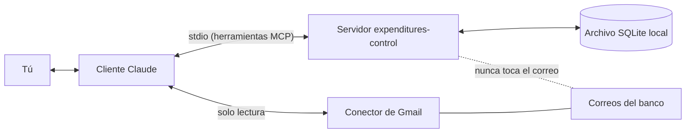

# Expenditures Control

Servidor MCP que guarda tus movimientos bancarios (COP), tomados de las notificaciones del banco, en un archivo SQLite local y permite que Claude responda preguntas de presupuesto por categoría y por mes.

[Read in English](README.md)

## Cómo se ve

Todas las cifras son inventadas.

> **Tú:** ¿Cómo me fue en octubre por categoría?
>
> **Claude:** Octubre 2026, gastado vs presupuesto:
>
> | Categoría | Gastado | Presupuesto | Usado |
> |---|---:|---:|---:|
> | Supermercado | 612.400 | 700.000 | 87% (alerta) |
> | Suscripcion | 148.900 | 200.000 | 74% |
> | Fijo | 1.350.000 | 1.350.000 | 100% |
> | Otro | 203.500 | sin presupuesto | |
>
> Hay 41.000 COP de gasto sin categoría (2 comercios). ¿Quieres clasificarlos?
>
> <details>
> <summary>Detalle: Supermercado</summary>
>
> | Fecha | Comercio | Monto |
> |---|---|---:|
> | 2026-10-03 | Supermercado Ejemplo | 134.588 |
> | 2026-10-11 | Tienda Ejemplo | 88.200 |
> | 2026-10-19 | Supermercado Ejemplo | 201.350 |
> | 2026-10-27 | Mercado Demo | 188.262 |
>
> </details>

Claude lee los correos de notificación del banco con su propio conector de Gmail, entrega a este servidor solo los datos extraídos y le consulta para responder.

## Cómo funciona



El servidor no tiene modelo de lenguaje ni acceso a la red por su cuenta. Claude (el cliente) lee e interpreta; el servidor valida, guarda y agrega.

## Privacidad

- El servidor nunca lee tu correo. Claude lee solo las notificaciones bancarias necesarias, con su conector de Gmail de solo lectura.
- Solo se guardan datos extraídos: fecha, monto, comercio, banco, tipo (gasto, ingreso, transferencia propia) y categoría. Nunca el texto de un correo.
- Todo vive en un archivo SQLite en tu computador. Este servidor no envía nada a ninguna parte.
- Ojo: cuando Claude lee tus correos o consulta los datos, ese contenido lo procesa tu cliente de Claude bajo sus propios términos de privacidad.

## Requisitos

- Node.js 22.5 o superior (el servidor usa `node:sqlite`, incluido en Node). Verifica con `node --version`.
- Un cliente MCP: Claude Code, Claude Desktop u otro que ejecute servidores stdio.
- Para sincronizar correo: Claude con un conector de Gmail.

## Instalación

### A. Claude Code

```bash
claude mcp add gastos -- npx -y expenditures-control
```

Para elegir dónde queda la base de datos:

```bash
claude mcp add gastos -e GASTOS_DB=/ruta/gastos.db -- npx -y expenditures-control
```

> El paquete npm aún no está publicado (ver Estado abajo). Mientras tanto, ejecútalo desde un clon: `npm install && npm run build` y luego `claude mcp add gastos -- node "/ruta/absoluta/dist/index.js"`.

### B. Claude Desktop (.mcpb, doble clic)

Aún no disponible. Desde el repositorio se puede construir un paquete de un clic (`npm run build:mcpb` genera `build/expenditures-control.mcpb`), pero no se ha verificado que el Node integrado en Claude Desktop incluya `node:sqlite`, así que no se ofrece como vía de instalación. Mientras tanto usa la opción C.

### C. Configuración manual en JSON (Claude Desktop y otros clientes)

Agrega esto a la configuración MCP del cliente (en Claude Desktop: Ajustes, Desarrollador, Editar configuración):

```json
{
  "mcpServers": {
    "gastos": {
      "command": "npx",
      "args": ["-y", "expenditures-control"],
      "env": { "GASTOS_DB": "/ruta/gastos.db" }
    }
  }
}
```

`env` es opcional. El Node que use el cliente debe ser 22.5 o superior; si tu cliente usa otro Node, pon en `command` la ruta completa de un `node` reciente y en `args` la ruta a `dist/index.js`.

## Dónde viven los datos

La base de datos es un solo archivo. Por defecto: `~/.gastos-mcp/gastos.db` (la carpeta se crea con permisos privados). Con `GASTOS_DB` eliges otra ruta; `~` se expande, vacío cuenta como no definida y `:memory:` da una base desechable.

- **Respaldo:** cierra el cliente y copia el archivo (`cp ~/.gastos-mcp/gastos.db ~/respaldo-gastos.db`). Copia también `gastos.db-wal` y `gastos.db-shm` si existen al lado.
- **Borrar todo:** elimina el archivo (`rm ~/.gastos-mcp/gastos.db*`). El próximo arranque crea una base vacía.

## Primer uso

1. **Agrega tus remitentes bancarios.** Pídele a Claude: "Agrega `BBVA@bbvanet.com.co` como remitente bancario." No hay ninguno por defecto; el servidor solo trata como notificación bancaria el correo de estas direcciones.
2. **Sincroniza.** Pide: "Sincroniza mis correos del banco." Claude busca en Gmail (solo lectura) correo nuevo de esos remitentes, omite lo ya registrado, interpreta cada comprobante y lo registra. Se omiten promociones, pagos rechazados y avisos de ingreso. Detalle para Claude y colaboradores: [docs/sync-guide.es.md](docs/sync-guide.es.md).
3. **Clasifica comercios.** Por cada comercio nuevo Claude pregunta la categoría una vez (`supermercado`, `suscripcion`, `fijo` u `otro`) y la recuerda, también para movimientos pasados.
4. **Define presupuestos.** "Fija un presupuesto de 700.000 para supermercado en todos los meses."
5. **Pregunta.** "¿Cómo me fue en octubre por categoría?", "¿Cuánto gasté en Supermercado Ejemplo este año?", "¿Qué gastos fijos faltan por pagar?"

### Excel de gastos fijos

Opcional. Crea un `.xlsx` con la primera hoja así (encabezados en la fila 1, sin importar mayúsculas):

| nombre | monto | comercio |
|---|---:|---|
| Arriendo | 1200000 | nombre del arrendador |
| Internet | 150000 | proveedor |

`comercio` es la palabra clave para detectar el pago entre tus movimientos (palabras completas; si está vacío se usa `nombre`). Luego pídele a Claude que lo importe desde la ruta del archivo. Importar reemplaza la lista anterior.

## Herramientas (13)

Los nombres de las herramientas están en español.

| Herramienta | Qué hace |
|---|---|
| `registrar_movimiento` | Guarda un movimiento interpretado (`sourceId` = id del correo evita duplicados). |
| `registrar_movimientos` | Guarda hasta 100 movimientos por lote; cada ítem se valida por separado. |
| `consultar_movimientos` | Filtra y agrupa movimientos (totales por categoría, banco, comercio, día o mes). |
| `clasificar_comercio` | Asigna categoría a un comercio y reclasifica todos sus gastos. |
| `fijar_presupuesto` | Define el presupuesto de una categoría para un mes (o `default`). |
| `estado_presupuesto` | Gastado vs presupuesto por categoría, alerta al 80% y gasto sin categoría. |
| `importar_gastos_fijos` | Carga la lista de gastos fijos desde un Excel. |
| `gastos_fijos_pendientes` | Gastos fijos de un mes: pagados y por pagar. |
| `ultimo_movimiento_registrado` | Fecha más reciente por banco, para saber desde dónde sincronizar. |
| `listar_remitentes` | Remitentes bancarios autorizados y la consulta de Gmail (`from:(a OR b)`). |
| `agregar_remitente` | Agrega un remitente (se guarda en minúsculas; debe contener `@`). |
| `quitar_remitente` | Quita un remitente. |
| `filtrar_no_registrados` | De una lista de ids de mensajes (máx. 500) devuelve los aún no registrados. |

## Solución de problemas

- **"node:sqlite" no se encuentra / el servidor se cierra al iniciar:** tu Node es anterior a 22.5. Ejecuta `node --version` y actualiza. Con un cliente gráfico, el Node que lanza puede ser distinto al de tu terminal; usa la opción de ruta completa de la instalación C.
- **No aparecen las herramientas:** reinicia el cliente tras agregar el servidor. En Claude Code ejecuta `claude mcp list` y confirma que `gastos` está conectado.
- **`npx` tarda la primera vez:** descarga el paquete una vez y luego lo deja en caché.
- **Los datos no están donde espero:** revisa `GASTOS_DB` en el entorno del servidor; sin ella el archivo es `~/.gastos-mcp/gastos.db`.
- **Un movimiento quedó mal leído:** todavía no hay herramienta para editar o borrar (ver Limitaciones).

## Limitaciones

- Todavía no hay herramienta para editar o borrar un movimiento.
- Los formatos de comprobante solo se han validado con correos de BBVA Colombia. Otros bancos pueden requerir nuevas reglas de interpretación en la guía de sincronización.
- Los montos son solo COP enteros.

Ideas para una segunda fase: editar y borrar movimientos, reglas de comprobantes para más bancos, más monedas.

## Estado y desarrollo

Versión previa (0.1.0). Aún no publicado en npm.

```bash
npm install
npm test            # pruebas unitarias
npm run typecheck
npm run build
npm run smoke:pack  # npm pack, instala el tarball en un temporal, verifica 13 herramientas por stdio
npm run build:mcpb  # opcional: genera build/expenditures-control.mcpb
```

Repositorio: https://github.com/estebanjc78/expenditures-control

## Licencia

TODO: el dueño aún no ha elegido licencia (se sugiere MIT). Mientras no exista un archivo LICENSE, todos los derechos están reservados.
