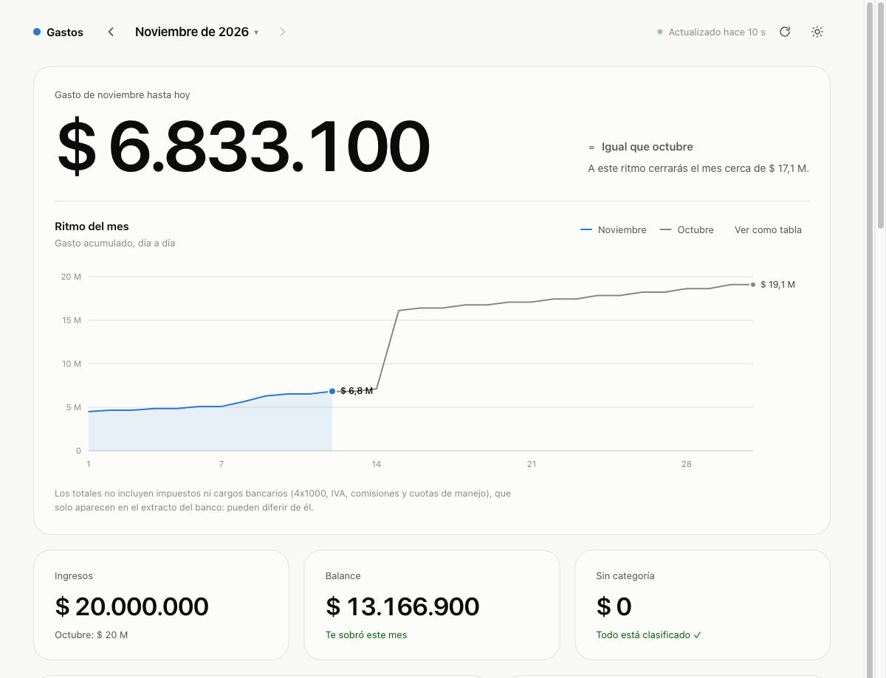
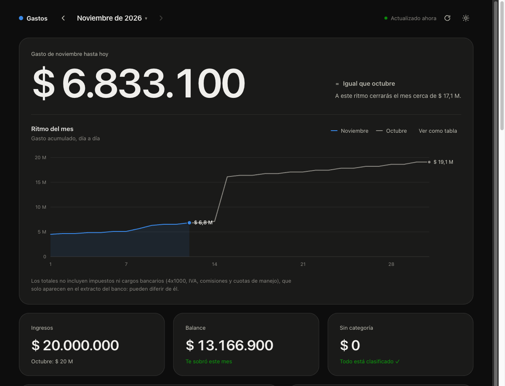
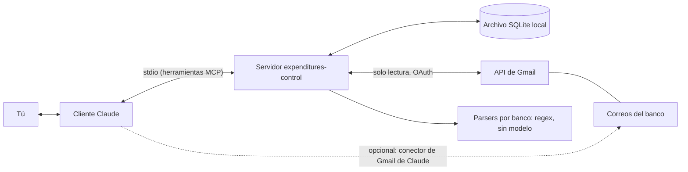

# Expenditures Control

Servidor MCP que guarda tus movimientos bancarios (COP), tomados de las notificaciones del banco, en un archivo SQLite local y permite que Claude responda preguntas de presupuesto por categoría y por mes.

[Read in English](README.md)

## Cómo se ve

Pídele a Claude **"muéstrame mis gastos"** y aparece **dentro de la conversación** un reporte visual e interactivo (Claude y Claude Desktop; es una MCP App, no se abre ningún navegador). Si no encuentras un movimiento ("no encuentro la transferencia del alquiler"), Claude muestra el reporte en el mes correcto con ese movimiento resaltado. Si el cliente no soporta MCP Apps, `abrir_panel` abre el mismo panel en tu navegador: un número protagonista, tu ritmo frente al mes anterior, categorías que se expanden con un clic, y **filtrado cruzado como en Power BI** (haz clic en una categoría, un comercio o un día y todos los gráficos, el ranking y la tabla resaltan esa misma selección), un gráfico día a día y una tabla con búsqueda. Corre solo en tu computador, se actualiza solo y sigue tu tema claro u oscuro. (Datos de demostración.)




O pregunta en texto.

Todas las cifras son inventadas.

> **Tú:** ¿Cómo me fue en octubre por categoría?
>
> **Claude:** Octubre 2026, gastado vs presupuesto:
>
> | Categoría | Gastado | Presupuesto | Usado |
> |---|---:|---:|---:|
> | Supermercado | 612.400 | 700.000 | 87% (alerta) |
> | Suscripcion | 148.900 | 200.000 | 74% |
> | Fijo | 1.350.000 | 1.350.000 | 100% |
> | Otro | 203.500 | sin presupuesto | |
>
> Hay 41.000 COP de gasto sin categoría (2 comercios). ¿Quieres clasificarlos?
>
> <details>
> <summary>Detalle: Supermercado</summary>
>
> | Fecha | Comercio | Monto |
> |---|---|---:|
> | 2026-10-03 | Supermercado Ejemplo | 134.588 |
> | 2026-10-11 | Tienda Ejemplo | 88.200 |
> | 2026-10-19 | Supermercado Ejemplo | 201.350 |
> | 2026-10-27 | Mercado Demo | 188.262 |
>
> </details>

El servidor puede leer por sí mismo tus correos de notificación del banco (acceso de solo lectura a Gmail, con una configuración única), extraer los datos con reglas por banco y dejar en el contexto de Claude solo un resumen corto. Así es práctico cargar meses de historial de una vez. Sin esa configuración, Claude igual puede leer los correos recientes con su propio conector de Gmail y entregarle al servidor los datos extraídos.

## Cómo funciona



El servidor no tiene modelo de lenguaje. Con Gmail conectado, el servidor descarga los correos de tus remitentes autorizados, extrae los movimientos con parsers por banco (expresiones regulares sobre el bloque "Detalles de la operación") y devuelve solo un resumen; Claude clasifica comercios y responde preguntas. El flujo completo está en [docs/diagrama-proceso-mcp.md](docs/diagrama-proceso-mcp.md).

## Privacidad

- El acceso a Gmail es opcional y de solo lectura (`gmail.readonly`). Una vez conectado, el servidor descarga únicamente los correos de los remitentes que autorizaste, solo para extraer los datos del movimiento.
- El token de OAuth vive en `~/.gastos-mcp/gmail-token.json` en tu computador (permisos solo para tu usuario). Puedes borrarlo cuando quieras con `desconectar_gmail` y revocar el permiso en <https://myaccount.google.com/permissions>.
- Solo se guardan datos extraídos: fecha, monto, comercio, banco, tipo (gasto, ingreso, transferencia propia) y categoría. Nunca el texto de un correo.
- Todo vive en archivos en tu computador. El único tráfico de red de este servidor es hacia las APIs de Google (Gmail e inicio de sesión) cuando conectas Gmail.
- Los nombres de comercios, montos y asuntos que devuelve el servidor los ve Claude, como cualquier resultado de una herramienta.
- El panel se sirve solo en `127.0.0.1` (nunca en la red), exige un token secreto que viaja en el fragmento de la URL, rechaza cualquier otro `Host`, es de solo lectura y no carga nada de internet.
- Ojo: cuando Claude lee tus correos o consulta los datos, ese contenido lo procesa tu cliente de Claude bajo sus propios términos de privacidad.

## Requisitos

- Node.js 22.13 o superior (el servidor usa `node:sqlite`, incluido en Node). Verifica con `node --version`.
- Un cliente MCP: Claude Code, Claude Desktop u otro que ejecute servidores stdio.
- Para sincronizar correo: conectar Gmail al servidor (tres clics, ver [docs/gmail-setup.es.md](docs/gmail-setup.es.md)) o usar el conector de Gmail de Claude.

## Instalación

### A. Claude Code

```bash
claude mcp add gastos -- npx -y expenditures-control
```

Para elegir dónde queda la base de datos:

```bash
claude mcp add gastos -e GASTOS_DB=/ruta/gastos.db -- npx -y expenditures-control
```

> El paquete npm aún no está publicado (ver Estado abajo). Mientras tanto, ejecútalo desde un clon: `npm install && npm run build` y luego `claude mcp add gastos -- node "/ruta/absoluta/dist/index.js"`.

### B. Claude Desktop (.mcpb, doble clic)

Construye el paquete desde el repositorio (`npm run build:mcpb` genera `build/expenditures-control.mcpb`), ábrelo con Claude Desktop y pulsa **Install**. El Node integrado en Claude Desktop incluye `node:sqlite` y el paquete se ha usado ahí para guardar movimientos. Todavía no hay descargas publicadas. Si prefieres no construirlo, usa la opción C.

### C. Configuración manual en JSON (Claude Desktop y otros clientes)

Agrega esto a la configuración MCP del cliente (en Claude Desktop: Ajustes, Desarrollador, Editar configuración):

```json
{
  "mcpServers": {
    "gastos": {
      "command": "npx",
      "args": ["-y", "expenditures-control"],
      "env": { "GASTOS_DB": "/ruta/gastos.db" }
    }
  }
}
```

`env` es opcional. El Node que use el cliente debe ser 22.13 o superior; si tu cliente usa otro Node, pon en `command` la ruta completa de un `node` reciente y en `args` la ruta a `dist/index.js`.

## Dónde viven los datos

La base de datos es un solo archivo. Por defecto: `~/.gastos-mcp/gastos.db` (la carpeta se crea con permisos privados). Con `GASTOS_DB` eliges otra ruta; `~` se expande, vacío cuenta como no definida y `:memory:` da una base desechable.

- **Respaldo:** cierra el cliente y copia el archivo (`cp ~/.gastos-mcp/gastos.db ~/respaldo-gastos.db`). Copia también `gastos.db-wal` y `gastos.db-shm` si existen al lado.
- **Borrar todo:** elimina el archivo (`rm ~/.gastos-mcp/gastos.db*`). El próximo arranque crea una base vacía.

## Primer uso

1. **Agrega tus remitentes bancarios.** Pídele a Claude: "Agrega `BBVA@bbvanet.com.co` como remitente bancario." No hay ninguno por defecto; el servidor solo trata como notificación bancaria el correo de estas direcciones.
2. **Conecta Gmail (una vez).** Pide: "Conecta mi Gmail", elige tu cuenta en el navegador y pulsa **Permitir** (Google muestra primero un aviso de "app no verificada"; ver [docs/gmail-setup.es.md](docs/gmail-setup.es.md)).
3. **Sincroniza.** Pide: "Sincroniza mis correos del banco desde 2026-09-01." El servidor descarga y procesa los correos por sí mismo y devuelve un resumen (registrados, omitidos, para revisar, comercios sin categoría). Se puede repetir sin riesgo. Sin la conexión de Gmail, Claude puede leer los correos recientes con su propio conector; ver [docs/sync-guide.es.md](docs/sync-guide.es.md).
4. **Clasifica comercios.** Claude clasifica los comercios nuevos por su nombre (`supermercado`, `suscripcion`, `fijo`, `otro`, `pse` o `transferencia`), te muestra la lista y tú corriges lo que esté mal. Cada comercio se clasifica una vez y se recuerda, también para movimientos pasados.
5. **Define presupuestos.** "Fija un presupuesto de 700.000 para supermercado en todos los meses."
6. **Pregunta.** "¿Cómo me fue en octubre por categoría?", "¿Cuánto gasté en Supermercado Ejemplo este año?", "¿Qué gastos fijos faltan por pagar?"

### Excel de gastos fijos

Opcional. Crea un `.xlsx` con la primera hoja así (encabezados en la fila 1, sin importar mayúsculas):

| nombre | monto | comercio |
|---|---:|---|
| Arriendo | 1200000 | nombre del arrendador |
| Internet | 150000 | proveedor |

`comercio` es la palabra clave para detectar el pago entre tus movimientos (palabras completas, sin distinguir acentos ni mayúsculas; si está vacío se usa `nombre`). Los bancos cortan los nombres largos, así que una palabra clave que termine en `*` también acepta la última palabra cortada (`compania de med*`). Luego pídele a Claude que lo importe desde la ruta del archivo. Importar reemplaza la lista anterior.

## Herramientas (25)

Los nombres de las herramientas están en español.

| Herramienta | Qué hace |
|---|---|
| `registrar_movimiento` | Guarda un movimiento interpretado (`sourceId` = id del correo evita duplicados). |
| `registrar_movimientos` | Guarda hasta 100 movimientos por lote; cada ítem se valida por separado. |
| `consultar_movimientos` | Filtra y agrupa movimientos (totales por categoría, banco, comercio, día o mes). |
| `clasificar_comercio` | Asigna categoría a un comercio y reclasifica todos sus gastos. |
| `fijar_presupuesto` | Define el presupuesto de una categoría para un mes (o `default`). |
| `estado_presupuesto` | Gastado vs presupuesto por categoría, alerta al 80% y gasto sin categoría. |
| `importar_gastos_fijos` | Carga la lista de gastos fijos desde un Excel. |
| `gastos_fijos_pendientes` | Gastos fijos de un mes: pagados y por pagar. |
| `ultimo_movimiento_registrado` | Fecha más reciente por banco, para saber desde dónde sincronizar. |
| `listar_remitentes` | Remitentes bancarios autorizados y la consulta de Gmail (`from:(a OR b)`). |
| `agregar_remitente` | Agrega un remitente (se guarda en minúsculas; debe contener `@`). |
| `quitar_remitente` | Quita un remitente. |
| `filtrar_no_registrados` | De una lista de ids de mensajes (máx. 500) devuelve los aún no registrados. |
| `conectar_gmail` | Conecta Gmail (solo lectura) con un clic de Permitir, una sola vez. |
| `estado_gmail` | Si Gmail está configurado, conectado o esperando tu autorización. |
| `desconectar_gmail` | Borra el token de Gmail guardado en este computador. |
| `sincronizar_gmail` | Descarga y procesa los correos del banco de un rango de fechas y registra los movimientos; devuelve un resumen. |
| `clasificar_comercios` | Clasifica varios comercios de una vez y reclasifica sus gastos. |
| `gastos_recurrentes_no_listados` | Suscripciones y gastos fijos del mes que no están en tu lista de gastos fijos: encuentra los que olvidaste. |
| `formatos_banco` | Qué bancos sabe leer el servidor (incluidos y aprendidos) y qué remitentes autorizados todavía necesitan reglas. |
| `configurar_formato_banco` | Enseña al servidor un banco nuevo con 3 o 4 comprobantes confirmados; se guarda solo si todos pasan. |
| `eliminar_formato_banco` | Borra las reglas aprendidas de un remitente. |
| `ver_panel` | Muestra el reporte interactivo dentro de la conversación; `resaltar` marca los movimientos que buscas (un concepto de gastos fijos, un nombre, un monto o una categoría). |
| `datos_panel` | Herramienta privada con la que el reporte pide sus propios datos; el modelo no la ve, así que los movimientos no entran a su contexto. |
| `abrir_panel` | Abre en tu navegador el panel interactivo de gastos (local, solo lectura). |

## Solución de problemas

- **"node:sqlite" no se encuentra / el servidor se cierra al iniciar:** tu Node es anterior a 22.13. Ejecuta `node --version` y actualiza. Con un cliente gráfico, el Node que lanza puede ser distinto al de tu terminal; usa la opción de ruta completa de la instalación C.
- **No aparecen las herramientas:** reinicia el cliente tras agregar el servidor. En Claude Code ejecuta `claude mcp list` y confirma que `gastos` está conectado.
- **`npx` tarda la primera vez:** descarga el paquete una vez y luego lo deja en caché.
- **Los datos no están donde espero:** revisa `GASTOS_DB` en el entorno del servidor; sin ella el archivo es `~/.gastos-mcp/gastos.db`.
- **Un movimiento quedó mal leído:** todavía no hay herramienta para editar o borrar (ver Limitaciones).

## Limitaciones

- Todavía no hay herramienta para editar o borrar un movimiento.
- La sincronización con Gmail usa una app de Google incluida en el paquete (el mantenedor la configura una sola vez, ver [docs/gmail-setup.es.md](docs/gmail-setup.es.md)). Hasta que Google la verifique, muestra una pantalla de "app no verificada" y permite 100 usuarios en total. Se probó con respuestas de Google simuladas y con formatos reales de correos de BBVA, pero todavía no de punta a punta contra los servidores de Google.
- BBVA Colombia viene incluido. **Cualquier otro banco se aprende con 3 o 4 avisos tuyos** (ver [docs/learn-a-bank.es.md](docs/learn-a-bank.es.md)): Claude redacta las reglas de lectura, el servidor las prueba contra los ejemplos que confirmaste y las guarda en tu base de datos. Probado con ejemplos inventados de Argentina y México, todavía no con correos reales de esos bancos. Una moneda por base de datos.
- Los impuestos y cargos bancarios que ningún correo trae (4x1000, IVA, comisiones, cuotas de manejo) no se reflejan; el panel lo aclara al pie del gráfico, así que los totales pueden diferir del extracto del banco.
- Las transferencias en moneda extranjera distintas de una conversión USD a COP no se registran solas; se reportan para tu revisión.
- El servidor confía en la dirección `From` que reporta Gmail y se apoya en la protección anti-suplantación de Gmail; todavía no verifica DKIM por su cuenta. El texto tomado de los correos (comercio, asunto) se limpia y se acota antes de llegar al modelo, pero trátalo como datos.
- Los montos son solo COP enteros.

Ideas para una segunda fase: editar y borrar movimientos, reglas de comprobantes para más bancos, más monedas.

## Estado y desarrollo

Versión previa (0.1.0). Aún no publicado en npm.

```bash
npm install
npm test            # pruebas unitarias
npm run typecheck
npm run build
npm run smoke:pack  # npm pack, instala el tarball en un temporal, verifica 25 herramientas por stdio
npm run build:mcpb  # opcional: genera build/expenditures-control.mcpb
```

Repositorio: https://github.com/estebanjc78/expenditures-control

## Licencia

[MIT](LICENSE) © 2026 Esteban J. Campos
