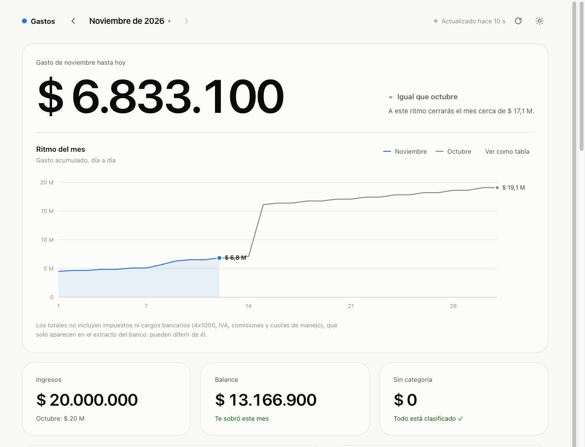
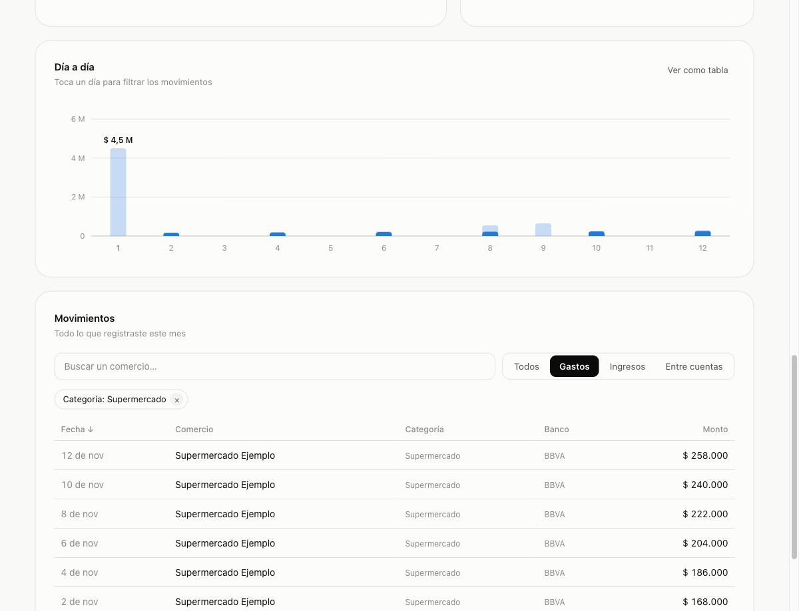
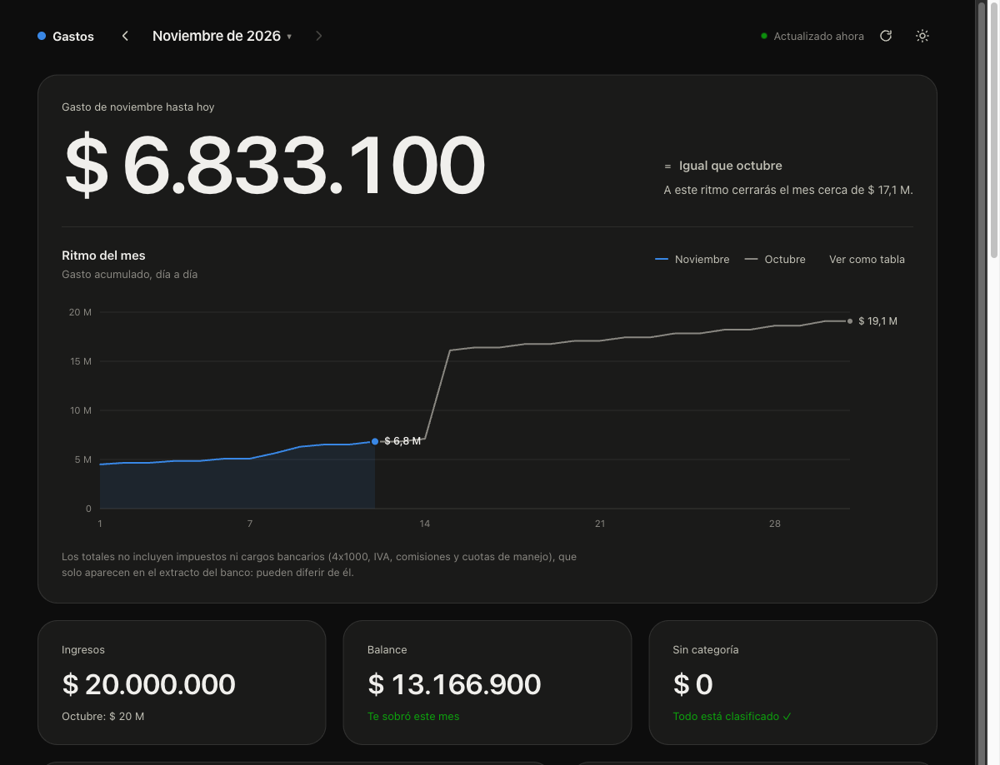
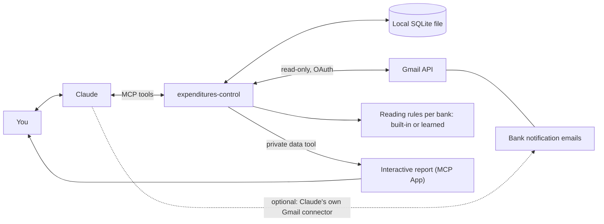

# Expenditures Control

**Your bank emails, turned into a live spending report inside Claude.**
A local-first MCP server that reads the notification emails your bank already sends, keeps the movements on your computer, and shows an interactive, Power BI-style report right in the conversation.

[Leer en español](README.es.md)



## Why it exists

Every purchase and transfer triggers an email from your bank. That is the one data source that works with any bank, needs no bank API or credentials, and is already in your inbox. This project turns those emails into structured data you own, then lets you explore it by talking to Claude **or** by clicking around a report that lives in the chat.

- **Any bank, any country.** BBVA Colombia is built in. For any other bank you show Claude 3 or 4 real notices and it learns the reading rules, which the server tests against your examples before saving them.
- **A report you can play with.** Click a category, a merchant or a day and every chart, ranking and the table highlight the same selection.
- **Ask in plain language.** "I can't find the rent transfer" opens the report on the right month with that movement highlighted.
- **Local-first.** Your data lives in one SQLite file on your machine. No cloud, no account.



## See it in a conversation

| You say | What happens |
|---|---|
| "Show me my spending" | The interactive report appears inside the conversation, with your pace against last month, categories, a day-by-day chart and a searchable table. |
| "I can't find the rent transfer" | Claude understands "rent" from your fixed-expenses list, opens the right month and highlights the movement. |
| "Which subscriptions am I paying that I don't track?" | Compares what was actually charged with your list and surfaces the forgotten ones. |
| "Learn my Galicia notices" | Claude asks for 3 or 4 real emails, confirms with you how each reads, writes the rules, and saves them only if every example passes. |
| "Sync my bank emails from September" | With Gmail connected, the server downloads and parses the mails itself and returns only a short summary. |

## Highlights

- **Interactive report as an MCP App**, rendered inside Claude (and Claude Desktop). The model only receives a short summary: the report fetches its own data through a private tool, so your movements never enter the model's context.
- **Learned bank formats.** Declarative, schema-validated rules per sender, tested against confirmed examples, stored in your database. Learned rules take priority over built-in ones, so a bank can be re-taught when its emails change.
- **Gmail sync from the server.** Read-only OAuth (PKCE, loopback), token kept locally. Months of history load in seconds without passing through the model.
- **Fixed expenses and forgotten subscriptions.** Import a spreadsheet of what you expect to pay; the server tells you what was paid, what is still due and what you pay without tracking. PSE payments, which hide the payee, are matched by amount.
- **Sensible accounting.** USD-to-COP conversions count as income, credit-card payments are own transfers (no double counting), PSE and transfers to people get their own categories.
- **Safe by construction.** Strict CSP, secret token and `127.0.0.1` only for the browser fallback; regexes proposed by a model run in an isolated context with a time limit; text taken from emails is cleaned and length-limited.



## How it works



The server has no language model. Claude does what needs judgment (classifying merchants, explaining, learning a new bank from examples); the server validates, stores, aggregates and extracts. The full flow is in [docs/diagrama-proceso-mcp.md](docs/diagrama-proceso-mcp.md) (in Spanish).

## Get started

**Requirements:** Node.js 22.13 or newer (the server uses the built-in `node:sqlite`) and Claude Desktop (or any MCP client that runs stdio servers; MCP Apps need a host that supports them, such as Claude Desktop).

### Claude Desktop (one-click bundle)

```bash
git clone https://github.com/estebanjc78/expenditures-control.git
cd expenditures-control
npm install
npm run build:mcpb        # produces build/expenditures-control.mcpb
```

Open `build/expenditures-control.mcpb` with Claude Desktop and click **Install**. Allow the report when Claude asks.

### Claude Code or other clients

```bash
npm install && npm run build
claude mcp add gastos -- node "/absolute/path/to/dist/index.js"
```

Set `GASTOS_DB=/path/to/gastos.db` in the server's environment to choose where the database goes (default `~/.gastos-mcp/gastos.db`). Without MCP Apps support, `abrir_panel` opens the same dashboard in your browser.

### First steps

1. **Add your bank sender:** "Add `BBVA@bbvanet.com.co` as a bank sender." Any other bank: see [Banks](#banks).
2. **Load movements.** Either ask Claude to read recent mails with its own Gmail connector, or connect Gmail to the server once ("Connect my Gmail") and ask "Sync my bank emails from 2026-09-01". See [docs/gmail-setup.md](docs/gmail-setup.md).
3. **Look at it:** "Show me my spending."
4. **Optional:** import a spreadsheet of fixed expenses and set a budget ("Set a 4,000,000 supermercado budget for every month").

Fixed-expenses spreadsheet: first sheet with headers `nombre`, `monto`, `comercio` (the keyword used to detect the payment: whole words, accents and case ignored; a trailing `*` also matches a truncated last word, like `compania de med*`). Importing replaces the previous list.

## Banks

BBVA Colombia is built in: purchases, received money (Bre-B and transfers), own transfers, transfers to people, PSE payments, bill payments and credit-card payments.

For any other bank, **teach it from examples**: add the sender, ask Claude to learn that bank, confirm how it reads 3 or 4 of your real notices, and the rules are stored in your database. Details, the rules format and the safety model: [docs/learn-a-bank.md](docs/learn-a-bank.md). It is tested with made-up Argentine and Mexican examples, not yet with real mails of those banks.

## Tools (25)

Tool names are in Spanish.

<details>
<summary>Show all tools</summary>

| Tool | What it does |
|---|---|
| `ver_panel` | Show the interactive report inside the conversation; `resaltar` highlights the movements you are looking for (a fixed-expense concept, a name, an amount or a category). |
| `datos_panel` | Private tool the report uses to fetch its own data; the model never sees it. |
| `abrir_panel` | Open the same dashboard in a browser window (local, read-only). |
| `registrar_movimiento` / `registrar_movimientos` | Save one movement, or up to 100 per batch; `sourceId` (the email id) prevents duplicates. |
| `consultar_movimientos` | Filter and group movements (by category, bank, merchant, day or month). |
| `clasificar_comercio` / `clasificar_comercios` | Assign a category to one merchant, or to many at once, and reclassify their expenses. |
| `fijar_presupuesto` / `estado_presupuesto` | Set a budget; spent vs budget per category with an alert at 80%. |
| `importar_gastos_fijos` / `gastos_fijos_pendientes` | Load the fixed-expenses list; what was paid and what is still due. |
| `gastos_recurrentes_no_listados` | Subscriptions and fixed charges you pay that are not in your list. |
| `ultimo_movimiento_registrado` | Latest movement date per bank. |
| `listar_remitentes` / `agregar_remitente` / `quitar_remitente` | Manage the authorized bank senders. |
| `filtrar_no_registrados` | From a list of email ids, the ones not registered yet. |
| `conectar_gmail` / `estado_gmail` / `desconectar_gmail` | Connect Gmail (read-only), check it, or delete the local token. |
| `sincronizar_gmail` | Download and parse bank mails for a date range; returns a summary. |
| `formatos_banco` | Which banks can be read (built-in and learned) and which senders still need rules. |
| `configurar_formato_banco` / `eliminar_formato_banco` | Learn a bank from confirmed examples (saved only if all pass), or delete its rules. |

</details>

## Privacy and security

- **Local-first.** One SQLite file on your computer. The only network traffic is to Google's APIs when you connect Gmail.
- **Read-only Gmail** (`gmail.readonly`), only for the senders you authorize, only to extract movement data. The token lives in `~/.gastos-mcp/gmail-token.json` (owner-only permissions); `desconectar_gmail` deletes it and you can revoke the permission at <https://myaccount.google.com/permissions>.
- **Only extracted data is stored**: date, amount, merchant, bank, kind and category, never the text of an email.
- **The report does not feed the model.** Its data comes through a tool the model cannot call, so movements stay out of the conversation context; the model receives a short summary.
- **Browser fallback hardening:** `127.0.0.1` only, secret token in the URL fragment, other `Host` headers refused, nonce-based CSP, read-only, nothing loaded from the internet.
- **Untrusted input is treated as such:** mail text is size-capped, parsers avoid backtracking-prone regexes, learned regexes run in an isolated context with a 150 ms limit, and values taken from emails are cleaned before reaching the model.
- When Claude reads your emails or queries your data, that content is processed under your Claude client's own privacy terms.

## Engineering notes

- **MCP end to end.** 25 tools over stdio, plus an MCP App (`ui://` resource) with a private app-only data tool.
- **Rules as data, not code.** A schema-validated profile per sender (labels, regexes, fixed values, date formats, currency, time zone), tested against examples before being saved.
- **Idempotent, resumable sync.** Mails already processed or discarded are never downloaded again; large ranges resume where they stopped.
- **Tested.** 289 unit and integration tests (parsers with hostile inputs, OAuth with a simulated Google, the MCP protocol in memory, CSP guards), type-checked TypeScript, and a packaging smoke test that installs the tarball and talks to it over stdio.
- **Reviewed.** The Gmail and parsing code went through a security review whose findings (ReDoS, poison mails, token handling, sender validation) were fixed and covered by tests.

## Limitations and roadmap

- Gmail sync from the server needs a Google OAuth client; until Google verifies the app it shows an "unverified app" screen and allows 100 users in total. It is covered by tests with a simulated Google, not yet run end to end against Google's servers by the maintainer.
- Bank taxes and fees that no email carries (4x1000, VAT, commissions, card maintenance fees) are not reflected; the report says so under its chart.
- No tool to edit or delete a movement yet; purchase reversals are not modeled yet.
- One currency per database. Foreign-currency transfers other than USD-to-COP conversions are reported for review instead of being registered.
- The report can be driven by Claude only when it is opened; moving an already-open report from the conversation needs a remote connector (planned).
- The server trusts the `From` address Gmail reports and does not verify DKIM itself yet.
- Roadmap: a remote connector (add by URL, works on web and mobile), editing and deleting movements, reversals, more banks and currencies.

## Development

```bash
npm install
npm test             # 289 tests
npm run typecheck
npm run build
npm run smoke:pack   # packs, installs the tarball in a temp dir, checks the 25 tools over stdio
npm run build:mcpb   # builds build/expenditures-control.mcpb
npm run panel:demo   # opens the report with made-up data (build first)
```

Troubleshooting: if `node:sqlite` is not found, your Node is older than 22.13 (a GUI client may launch a different Node than your shell); if the tools do not appear, restart the client; data lives at `GASTOS_DB` or `~/.gastos-mcp/gastos.db` (back it up by copying the file and its `-wal`/`-shm` neighbors when the client is closed).

## License

[MIT](LICENSE) © 2026 Esteban J. Campos
