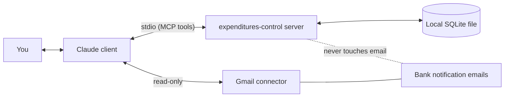

# Expenditures Control

An MCP server that keeps your bank-notification movements (COP) in a local SQLite file and lets Claude answer budget questions by category and month.

[Leer en español](README.es.md)

## What it looks like

All figures below are made up.

> **You:** How did October go by category?
>
> **Claude:** October 2026, spent vs budget:
>
> | Category | Spent | Budget | Used |
> |---|---:|---:|---:|
> | Supermercado | 612,400 | 700,000 | 87% (alert) |
> | Suscripcion | 148,900 | 200,000 | 74% |
> | Fijo | 1,350,000 | 1,350,000 | 100% |
> | Otro | 203,500 | no budget | |
>
> 41,000 COP of spending is still uncategorized (2 merchants). Want to classify them?
>
> <details>
> <summary>Detail: Supermercado</summary>
>
> | Date | Merchant | Amount |
> |---|---|---:|
> | 2026-10-03 | Supermercado Ejemplo | 134,588 |
> | 2026-10-11 | Tienda Ejemplo | 88,200 |
> | 2026-10-19 | Supermercado Ejemplo | 201,350 |
> | 2026-10-27 | Mercado Demo | 188,262 |
>
> </details>

Claude reads the bank notification emails with its own Gmail connector, hands this server only the extracted data, and queries the server to answer.

## How it works



The server has no language model and no network access of its own. Claude (the client) does the reading and interpreting; the server validates, stores and aggregates.

## Privacy

- The server never reads your email. Claude reads only the bank notifications it needs, through its own read-only Gmail connector.
- The server stores only extracted data: date, amount, merchant, bank, kind (expense, income, own transfer) and category. It never stores the text of an email.
- Everything lives in one SQLite file on your computer. Nothing is sent anywhere by this server.
- Note: when Claude reads your emails or queries the data, that content is processed by your Claude client under its own privacy terms.

## Requirements

- Node.js 22.5 or newer (the server uses the built-in `node:sqlite`). Check with `node --version`.
- An MCP client: Claude Code, Claude Desktop, or any client that runs stdio servers.
- For email sync: Claude with a Gmail connector.

## Install

### A. Claude Code

```bash
claude mcp add gastos -- npx -y expenditures-control
```

To choose where the database goes:

```bash
claude mcp add gastos -e GASTOS_DB=/path/to/gastos.db -- npx -y expenditures-control
```

> The npm package is not published yet (see Status below). Until then, run it from a clone: `npm install && npm run build`, then `claude mcp add gastos -- node "/absolute/path/to/dist/index.js"`.

### B. Claude Desktop (.mcpb, double-click)

Not available yet. A one-click bundle can be built from the repo (`npm run build:mcpb` produces `build/expenditures-control.mcpb`), but it has not been verified that the Node runtime built into Claude Desktop includes `node:sqlite`, so it is not offered as an install path. Use C below in the meantime.

### C. Manual JSON config (Claude Desktop and other clients)

Add this to the client's MCP config (for Claude Desktop: Settings, Developer, Edit Config):

```json
{
  "mcpServers": {
    "gastos": {
      "command": "npx",
      "args": ["-y", "expenditures-control"],
      "env": { "GASTOS_DB": "/path/to/gastos.db" }
    }
  }
}
```

`env` is optional. The Node used by the client must be 22.5 or newer; if your client uses a different Node, set `command` to the full path of a recent `node` and `args` to the path of `dist/index.js`.

## Where the data lives

The database is one file. Default: `~/.gastos-mcp/gastos.db` (the folder is created with private permissions). Set `GASTOS_DB` to use another path; `~` is expanded, an empty value counts as unset, and `:memory:` gives a throwaway database.

- **Back up:** close the client and copy the file (`cp ~/.gastos-mcp/gastos.db ~/gastos-backup.db`). Also copy `gastos.db-wal` and `gastos.db-shm` if they exist next to it.
- **Delete everything:** remove the file (`rm ~/.gastos-mcp/gastos.db*`). The next start creates an empty database.

## First use

1. **Add your bank senders.** Ask Claude: "Add `BBVA@bbvanet.com.co` as a bank sender." There are none by default; the server only treats mail from these addresses as bank notifications.
2. **Sync.** Ask: "Sync my bank emails." Claude searches Gmail (read-only) for new mail from those senders, skips ones already registered, interprets each receipt and registers it. Promotions, rejected payments and login notices are skipped. Details for Claude and contributors: [docs/sync-guide.md](docs/sync-guide.md).
3. **Classify merchants.** For each new merchant Claude asks the category once (`supermercado`, `suscripcion`, `fijo` or `otro`) and remembers it, including for past movements.
4. **Set budgets.** "Set a 700,000 supermercado budget for every month."
5. **Ask.** "How did October go by category?", "What did I spend at Supermercado Ejemplo this year?", "Which fixed expenses are still unpaid?"

### Fixed-expenses Excel

Optional. Create an `.xlsx` with the first sheet like this (headers on row 1, case-insensitive):

| nombre | monto | comercio |
|---|---:|---|
| Rent | 1200000 | landlord name |
| Internet | 150000 | ISP |

`comercio` is the keyword used to detect the payment among your movements (whole words; if empty, `nombre` is used). Then ask Claude to import it from the file path. Importing replaces the previous list.

## Tools (13)

The tool names are in Spanish.

| Tool | What it does |
|---|---|
| `registrar_movimiento` | Save one interpreted movement (`sourceId` = email id prevents duplicates). |
| `registrar_movimientos` | Save up to 100 movements per batch; each item is validated separately. |
| `consultar_movimientos` | Filter and group movements (totals by category, bank, merchant, day or month). |
| `clasificar_comercio` | Assign a category to a merchant and reclassify all its expenses. |
| `fijar_presupuesto` | Set the budget of a category for a month (or `default`). |
| `estado_presupuesto` | Spent vs budget per category, alert at 80%, plus uncategorized spend. |
| `importar_gastos_fijos` | Load the fixed-expenses list from an Excel file. |
| `gastos_fijos_pendientes` | Fixed expenses of a month: paid and still due. |
| `ultimo_movimiento_registrado` | Latest movement date per bank, to know where to sync from. |
| `listar_remitentes` | Authorized bank senders and the Gmail query (`from:(a OR b)`). |
| `agregar_remitente` | Add a bank sender (stored lowercase, must contain `@`). |
| `quitar_remitente` | Remove a bank sender. |
| `filtrar_no_registrados` | From a list of message ids (max 500), return those not registered yet. |

## Troubleshooting

- **"node:sqlite" not found / server exits at start:** your Node is older than 22.5. Run `node --version` and upgrade. With a GUI client, the Node it launches may differ from your shell's; use the full-path option in install C.
- **The tools do not appear:** restart the client after adding the server. In Claude Code run `claude mcp list` and check that `gastos` is connected.
- **`npx` is slow the first time:** it downloads the package once, then caches it.
- **Data is not where I expect:** check `GASTOS_DB` in the server's env; without it the file is `~/.gastos-mcp/gastos.db`.
- **A movement was read wrong:** there is no edit or delete tool yet (see Limitations).

## Limitations

- No tool to edit or delete a movement yet.
- Receipt formats have only been validated against BBVA Colombia emails. Other banks may need new interpretation rules in the sync guide.
- Amounts are integer COP only.

Roadmap ideas for a second phase: edit and delete movements, receipt rules for more banks, more currencies.

## Status and development

Pre-release (0.1.0). Not published to npm yet.

```bash
npm install
npm test            # unit tests
npm run typecheck
npm run build
npm run smoke:pack  # npm pack, install the tarball in a temp dir, check 13 tools over stdio
npm run build:mcpb  # optional: builds build/expenditures-control.mcpb
```

Repository: https://github.com/estebanjc78/expenditures-control

## License

TODO: the owner has not chosen a license yet (MIT is the suggested default). Until a LICENSE file is added, all rights are reserved.
