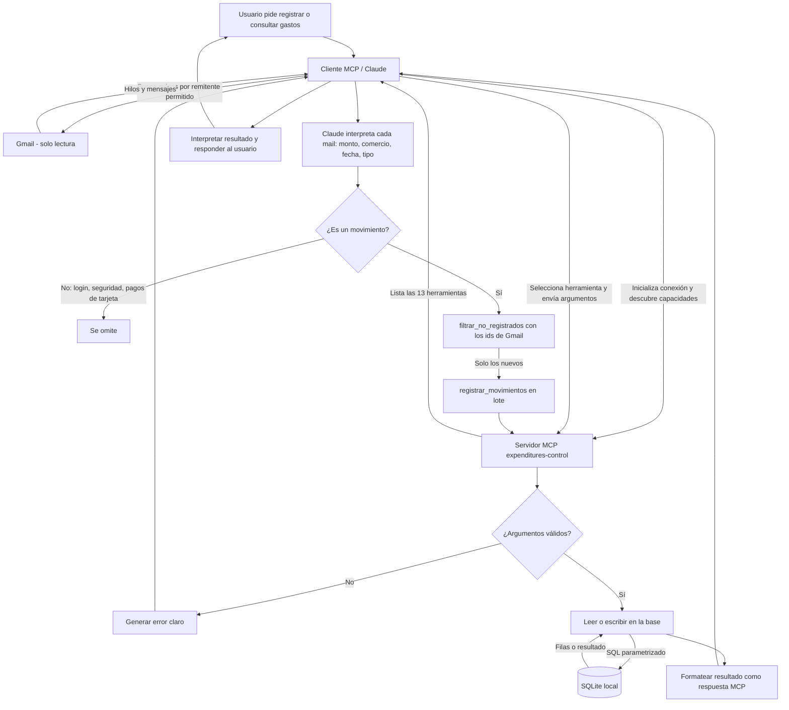

# Diagrama de proceso: MCP de gastos

Flujo de una solicitud desde el asistente hasta la base SQLite local y de vuelta. El servidor no tiene modelo de lenguaje y nunca toca el correo: Claude (cliente) lee Gmail en modo solo lectura, interpreta cada aviso del banco y llama a las herramientas del servidor.

## Pasos

1. El cliente MCP establece la sesión con el servidor y consulta sus capacidades.
2. Claude busca en Gmail (solo lectura) los avisos de los remitentes permitidos e interpreta cada uno.
3. Los avisos que no son movimientos se omiten. Los demás se cruzan con `filtrar_no_registrados` usando el id del mensaje de Gmail, para no duplicar.
4. Los movimientos nuevos se guardan en lote con `registrar_movimientos`.
5. Para consultas (presupuesto, categorías, meses), Claude elige la herramienta y envía sus argumentos.
6. El servidor valida la solicitud, opera sobre la base SQLite local y devuelve el resultado, o un error explícito.
7. Claude interpreta la respuesta y se la comunica al usuario.
