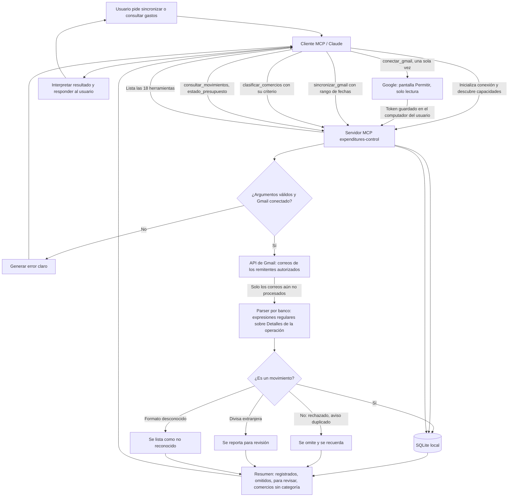

# Diagrama de proceso: MCP de gastos

Flujo de una solicitud desde el asistente hasta la base SQLite local y de vuelta. El servidor no tiene modelo de lenguaje: lee Gmail por su cuenta (solo lectura, con el permiso que das una vez), extrae los datos con reglas por banco y le devuelve a Claude solo un resumen. Claude clasifica los comercios y responde las preguntas.

## Pasos

1. El cliente MCP establece la sesión con el servidor y consulta sus capacidades.
2. Una sola vez, `conectar_gmail` abre la pantalla de Google; el usuario toca Permitir (solo lectura) y el token queda guardado localmente.
3. `sincronizar_gmail(desde, hasta)`: el servidor busca en Gmail los correos de los remitentes autorizados, descarta los ya procesados y extrae los datos del bloque "Detalles de la operación" con reglas por banco. Ningún correo pasa por el contexto de Claude.
4. Los movimientos nuevos se guardan en SQLite. Los avisos rechazados o duplicados se omiten, las divisas extranjeras y los formatos desconocidos se reportan.
5. El servidor devuelve un resumen. Si quedan correos, Claude vuelve a llamar a la herramienta con las mismas fechas.
6. Claude clasifica los comercios nuevos con `clasificar_comercios` y le muestra la lista al usuario para que corrija lo que haga falta.
7. Para consultas (presupuesto, categorías, meses), Claude elige la herramienta, el servidor valida, consulta la base y devuelve el resultado.
8. Claude interpreta la respuesta y se la comunica al usuario.
