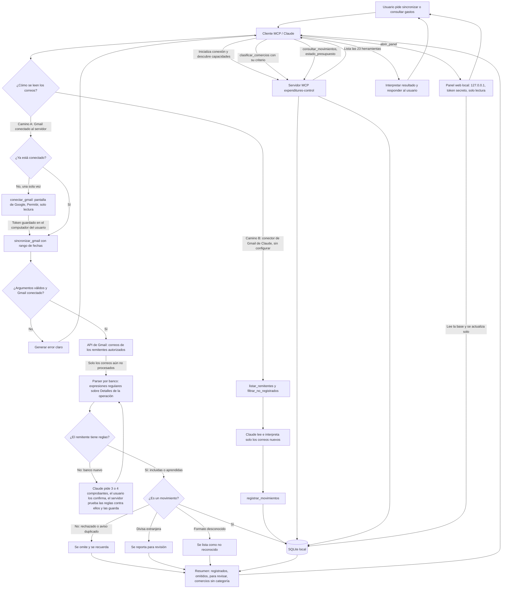

# Diagrama de proceso: MCP de gastos

Flujo de una solicitud desde el asistente hasta la base SQLite local y de vuelta. El servidor no tiene modelo de lenguaje. Los correos del banco se pueden leer por dos caminos y los dos terminan en la misma base: Claude clasifica los comercios y responde las preguntas.

- **Camino A, Gmail conectado al servidor:** el servidor lee Gmail por su cuenta (solo lectura, con el permiso que el usuario da una vez), extrae los datos con reglas por banco y le devuelve a Claude solo un resumen. Sirve para cargar meses de historial.
- **Camino B, conector de Gmail de Claude:** no requiere configurar nada. Claude lee los correos recientes y le entrega al servidor los datos ya extraídos. Sirve para el uso diario.

## Pasos

1. El cliente MCP establece la sesión con el servidor y consulta sus capacidades.
2. **Camino A.** Una sola vez, `conectar_gmail` abre la pantalla de Google; el usuario elige su cuenta, pulsa Permitir (solo lectura) y el token queda guardado localmente. La app de Google viene incluida en el paquete `.mcpb`; mientras Google no la verifique, hay un aviso de "app no verificada" y un tope de 100 usuarios.
3. **Camino A.** `sincronizar_gmail(desde, hasta)`: el servidor busca en Gmail los correos de los remitentes autorizados, descarta los ya procesados y extrae los datos del bloque "Detalles de la operación" con reglas por banco. Ningún correo pasa por el contexto de Claude.
4. Los movimientos nuevos se guardan en SQLite. Los avisos rechazados o duplicados se omiten; las divisas extranjeras y los formatos desconocidos se reportan.
5. El servidor devuelve un resumen. Si quedan correos, Claude vuelve a llamar a la herramienta con las mismas fechas.
6. **Camino B.** Sin conexión propia a Gmail, Claude usa su conector: `listar_remitentes` da la búsqueda, `filtrar_no_registrados` deja solo los correos nuevos, Claude los lee y guarda los datos con `registrar_movimientos`. Cada correo leído ocupa unos 5.000 tokens de contexto, por eso conviene para pocos correos.
7. Claude clasifica los comercios nuevos con `clasificar_comercios` y le muestra la lista al usuario para que corrija lo que haga falta.
8. Para consultas (presupuesto, categorías, meses), Claude elige la herramienta, el servidor valida, consulta la base y devuelve el resultado.
9. Claude interpreta la respuesta y se la comunica al usuario.
10. Si el usuario prefiere verlo, `abrir_panel` abre en su navegador un panel interactivo (gráficos, categorías, comparación con el mes anterior). El panel lee la misma base, solo escucha en `127.0.0.1` y se refresca solo cuando llegan movimientos nuevos.
