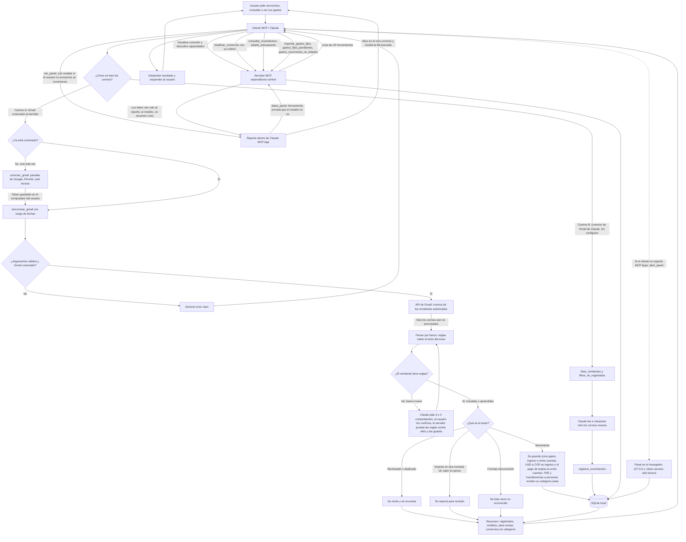

# Diagrama de proceso: MCP de gastos

Flujo de una solicitud desde el asistente hasta la base SQLite local y de vuelta. El servidor no tiene modelo de lenguaje. Los correos del banco se pueden leer por dos caminos y los dos terminan en la misma base. Claude clasifica los comercios y responde las preguntas, y el reporte se ve dentro de la conversación.

- **Camino A, Gmail conectado al servidor:** el servidor lee Gmail por su cuenta (solo lectura, con el permiso que el usuario da una vez), extrae los datos con reglas por banco y le devuelve a Claude solo un resumen. Sirve para cargar meses de historial.
- **Camino B, conector de Gmail de Claude:** no requiere configurar nada. Claude lee los correos recientes y le entrega al servidor los datos ya extraídos. Sirve para el uso diario.
- **Reporte:** una MCP App que Claude dibuja dentro del chat. Pide sus datos con una herramienta privada, así los movimientos no entran al contexto del modelo.

## Pasos

1. El cliente MCP establece la sesión con el servidor y consulta sus capacidades.
2. **Camino A.** Una sola vez, `conectar_gmail` abre la pantalla de Google; el usuario elige su cuenta, pulsa Permitir (solo lectura) y el token queda guardado localmente. Mientras Google no verifique la app, hay un aviso de "app no verificada" y un tope de 100 usuarios.
3. **Camino A.** `sincronizar_gmail(desde, hasta)`: el servidor busca en Gmail los correos de los remitentes autorizados, descarta los ya procesados y extrae los datos con las reglas del banco. Ningún correo pasa por el contexto de Claude.
4. **Bancos nuevos.** Si un remitente no tiene reglas, Claude le pide al usuario 3 o 4 comprobantes reales, confirma con él cómo se leen y redacta las reglas. El servidor las prueba contra esos ejemplos y solo las guarda si todos pasan (`configurar_formato_banco`).
5. Los movimientos se guardan en SQLite. Una conversión USD a COP entre cuentas propias cuenta como ingreso por los pesos recibidos; el pago de una tarjeta de crédito es un movimiento entre cuentas, para no duplicar las compras de la tarjeta. Los pagos PSE y las transferencias a personas reciben su categoría automáticamente, salvo que el usuario ya haya clasificado ese comercio.
6. El servidor devuelve un resumen. Si quedan correos, Claude vuelve a llamar a la herramienta con las mismas fechas.
7. **Camino B.** Sin conexión propia a Gmail, Claude usa su conector: `listar_remitentes` da la búsqueda, `filtrar_no_registrados` deja solo los correos nuevos, Claude los lee y guarda los datos con `registrar_movimientos`. Cada correo leído ocupa unos 5.000 tokens de contexto, por eso conviene para pocos correos.
8. Claude clasifica los comercios nuevos con `clasificar_comercios` y le muestra la lista al usuario para que corrija lo que haga falta.
9. **Gastos fijos.** Con la lista importada, `gastos_fijos_pendientes` dice qué se pagó y qué falta (los pagos PSE se emparejan por monto, porque el aviso no dice a quién se pagó) y `gastos_recurrentes_no_listados` encuentra suscripciones que se pagan y no están en la lista.
10. **Reporte.** `ver_panel` muestra dentro del chat un reporte interactivo: el gasto del mes, el ritmo contra el mes anterior, categorías que se expanden, un gráfico por día y una tabla con búsqueda. El reporte pide sus datos con `datos_panel`, una herramienta que el modelo no ve, y Claude solo recibe un resumen corto.
11. **Resaltado.** Si el usuario dice "no encuentro la transferencia del alquiler", Claude llama a `ver_panel` con `resaltar`. El servidor entiende "alquiler" como un concepto de la lista de gastos fijos (o un nombre, un monto o una categoría), busca el movimiento en cualquier mes y el reporte se abre en el mes correcto con la fila resaltada.
12. Si el cliente no soporta MCP Apps, `abrir_panel` abre el mismo panel en el navegador. Solo escucha en `127.0.0.1`, exige un token secreto y es de solo lectura.
13. Los totales no incluyen impuestos ni cargos bancarios (4x1000, IVA, comisiones, cuotas de manejo), que ningún correo trae y solo aparecen en el extracto; el reporte lo aclara al pie del gráfico.
